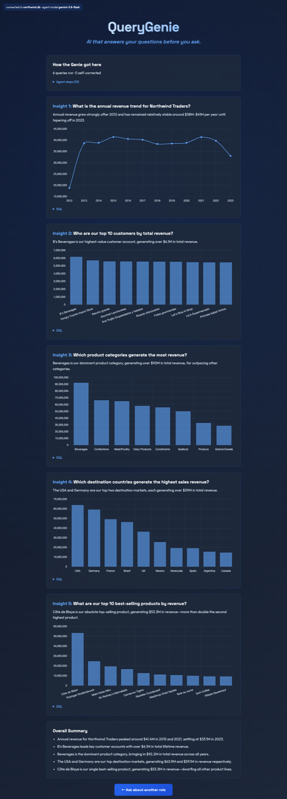
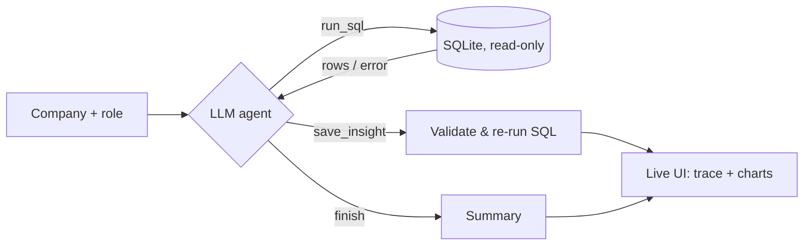

# QueryGenie
[](https://github.com/InbalBolshinsky/QueryGenie/actions/workflows/ci.yml)
[](https://www.ortra.com/events/hackathon5/%D7%AA%D7%9B%D7%A0%D7%99%D7%AA.aspx)

> **AI that answers your questions before you ask.**

Tell QueryGenie what your company does and what your job is. An **AI agent** then explores the company database by
itself: it decides what's worth knowing for your role, writes SQL, reads the results, fixes its own mistakes, and comes
back with charts and a short summary. You watch every step live as it happens.

Originally built at the **8<sup>th</sup> National Israeli Hackathon** at HIT (Holon Institute of Technology), then rebuilt
as a real tool-using agent.

<p align="center">
  
  <br><sub>A real run for a "Head of Sales": the agent ran 6 queries and produced 5 charts and a summary, all from the database.</sub>
</p>

---

## How the agent works

The LLM isn't asked for a single answer. It gets **three tools** and runs in a loop until it decides it's done:

| Tool | What it does |
|---|---|
| `run_sql(sql)` | Runs a read-only query and returns rows, or the SQLite error so the agent can fix its query |
| `save_insight(question, sql, chart, …)` | Saves a finding as a chart. The backend **re-runs the SQL** and checks the chart columns, so every chart shows real data, never numbers the model made up |
| `finish(summary)` | Ends the run with 3–5 key findings (rejected until at least 3 insights exist) |



What makes it an agent rather than a prompt:
- **It plans its own work.** No fixed list of questions; it checks the data's date range, explores, then picks what matters for the role.
- **It recovers from errors.** Failed SQL goes back to the model as a tool result, and it rewrites the query. The UI counts these self-corrections.
- **Its output is grounded.** Charts come from the database, not from model text.
- **It has guardrails.** Read-only connection, SELECT only, row caps, query timeout, step limit.

The whole agent (prompt, tool definitions and loop) is one file of plain Python under 200 lines, [backend/app/agent.py](backend/app/agent.py), with no agent framework.

## Tech stack

| Layer | Tools |
|---|---|
| Agent / LLM | Any OpenAI-compatible model through the `openai` SDK; **default: Google Gemini free tier** (`gemini-3.8-flash`) |
| Backend | Python, FastAPI, streaming NDJSON, SQLite, [uv](https://docs.astral.sh/uv/) |
| Frontend | React 19, TypeScript, Vite, Chart.js |
| Data | Northwind demo DB (SQLite, ~16k orders 2012–2023), downloaded automatically on first run |
| Quality | pytest (agent loop tested with a scripted fake LLM), GitHub Actions CI |

## Quick start

You need [uv](https://docs.astral.sh/uv/getting-started/installation/), Node 20+, and a **free** LLM key.

**1. Get a free key.** Create a Gemini API key at [aistudio.google.com/apikey](https://aistudio.google.com/apikey) (no credit card).
Prefer something else? [backend/.env.example](backend/.env.example) also shows Groq (free tier) and Ollama (runs locally, no key).

```bash
cp backend/.env.example backend/.env    # then paste your key into LLM_API_KEY
```

**2. Run it (development):**
```bash
# terminal 1: API on :8000 (downloads the demo DB on first start)
cd backend && uv run uvicorn app.main:app --reload

# terminal 2: UI on :5173
cd frontend && npm install && npm run dev
```
Open http://localhost:5173 and click **Fill in an example**, or describe your own role.

**Single-server mode:** run `cd frontend && npm run build`, then just the backend command. The app is served at http://localhost:8000.

**Use your own data:** point `DATABASE_PATH` in `backend/.env` at any SQLite file.

## Deploy (free)

[](https://render.com/deploy?repo=https://github.com/InbalBolshinsky/QueryGenie)

1. Click the button (or in Render: **New → Blueprint** and pick this repo). It reads [render.yaml](render.yaml).
2. Paste your Gemini key when it asks for `LLM_API_KEY`.
3. Render builds the [Dockerfile](Dockerfile) and gives you a `https://<name>.onrender.com` URL. It redeploys on every push to `main` once CI passes.

The free instance sleeps after 15 minutes without traffic, so the first visit after a break takes about a minute to wake up.

The same image runs anywhere Docker does:
```bash
docker build -t querygenie . && docker run -p 8000:8000 -e LLM_API_KEY=your-key querygenie
```

## Tests

```bash
cd backend && uv run pytest
```
The tests drive the real agent loop with a scripted fake LLM, so they cost nothing. They cover self-correction after a SQL
error, insight validation, the `finish` guard, read-only enforcement, and the streaming API.

## Project structure

```text
backend/
  app/agent.py      # system prompt, tool definitions, agent loop
  app/db.py         # read-only SQLite access + schema description for the LLM
  app/main.py       # FastAPI: /api/analyze (streams agent events), /api/health, /api/schema
  tests/            # agent + API tests with a fake LLM
frontend/
  src/api.ts        # types + streaming client
  src/App.tsx       # form → live agent trace → insights + summary
  src/components/   # QueryForm, AgentTrace, InsightCard
```

## License
MIT. See [LICENSE](LICENSE).
